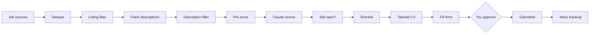

# How it works

The split is simple: **Python does everything that must be exact and repeatable** (fetching, filtering, the
database, form-fill scripts), and **Claude does what needs judgment** (scoring a posting against your CV, answering
form questions, driving the browser when a form is unusual).

## The steps

1. **Sources** (`jobhunt/sources/`) fetch new postings since the last scan: LinkedIn's public job search, company
   career sites from `companies.yaml`, and the job boards enabled for your country.
2. **Dedupe** (`jobhunt/pipeline.py`) merges the same job seen on several sites (same company and role, another
   city or a re-posted id).
3. **Filters** (`jobhunt/prefilter.py`) drop what you can't or won't take, using your `search:` settings: senior
   titles, other cities without remote, remote limited to another country's residents, required languages you don't
   speak, too many years of experience, titles you excluded (and non-tech titles if you chose IT roles only). Every dropped job keeps its reason (`filter_reason`).
4. **Pre-score** (`jobhunt/prescore.py`) ranks what's left cheaply, so Claude reads the most promising postings first.
5. **Claude scores** each posting 0-100 against your profile and writes what matches, what's missing and red flags.
6. **Still open?** (`jobhunt verify`) checks the job board and the employer's own site, and notes employer-side
   requirements the board didn't show.
7. **Shortlist → `/tailor-cv` → `/apply`.** `/tailor-cv` adds skills you confirm to a copy of your CV's Word file
   (`jobhunt/cvtailor.py`); `/apply` writes a cover letter PDF per job from profile facts only (`jobhunt/cover.py`).
   Fill scripts in `browser/ats/` cover Workday, SuccessFactors and SmartRecruiters; other forms are filled step by
   step. Answers come from your profile and the answer bank; unknown questions are asked once and saved.
8. **Inbox tracking** (`jobhunt/mailcheck.py`, `jobhunt/history.py`) reads the job inbox and moves applications to
   rejected / interview / offer.

## Job statuses

`new` → `filtered` (dropped by a rule) or `scored` → `shortlisted` → `applying` → `needs_input` (waiting for you)
→ `applied` → `interview` / `rejected` / `offer`. Side exits: `skipped` (you decided), `manual` (you apply
yourself, e.g. LinkedIn Easy Apply), `closed` (posting gone).

## Where things live

| Path | What | In git? |
|---|---|---|
| `profile/profile.yaml` | your profile and `search:` settings | no |
| `profile/*.pdf`, `profile/cv-source/` | your CVs | no |
| `data/jobhunt.db` | jobs, applications, answer bank, inbox history | no |
| `data/inbox/` | scratch files: scans, tailored CVs, cover letters | no |
| `reports/` | daily HTML reports | no |
| `companies.yaml` | your career-site watchlist (starts empty, yours to fill) | no |
| `companies.example.yaml` | the watchlist format and template | yes |
| `setup/starter-questions.yaml` | questions `/setup` asks once | yes |

## Adding a job board for your country

1. Add a module to `jobhunt/sources/` that returns `Job` objects (see `englishjobs.py` for a small one), with an
   optional `enrich` that fetches full descriptions.
2. Register it in `jobhunt/pipeline.py`, and list it under your country code in `COUNTRY_SOURCES` in
   `jobhunt/settings.py`.
3. Add a test with a saved sample page in `tests/fixtures/`, then run `uv run pytest -q`.

## Adding companies

`companies.yaml` entries look like `{name: "Acme", ats: workday, slug: "acme/wd3/External"}`. The slug format for
each ATS is explained at the top of the file. `uv run jobhunt doctor` checks the file loads.
